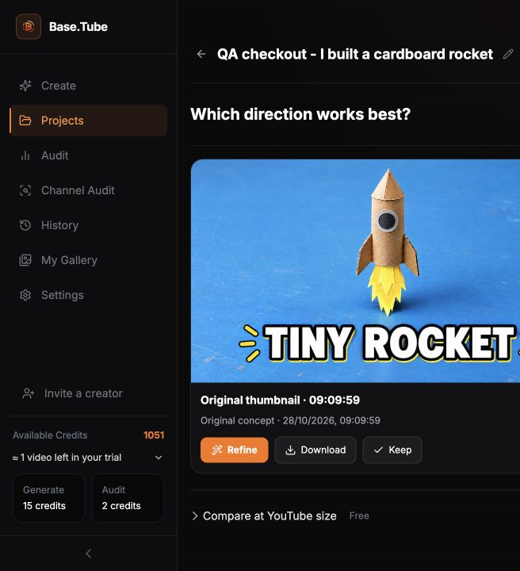

# Checkout QA — existing owner account — 28 October 2026

The Creator trial checkout, preserved Studio brief, real thumbnail generation,
and a separate explicitly approved US$5 sandbox credit-pack purchase completed.
All transactions used Stripe test mode (`livemode: false`) and the documented
4242 test card. No real money was charged. This is an existing-account journey;
new-account registration and real-money collection remain separate checks.

## Results and account state

| Step | Observed result | Available credits |
|---|---|---:|
| Initial account | No subscription; existing gift/pack credits | 836 |
| Cancel first successfully opened trial checkout | Returned to pricing; no grant or subscription | 836 |
| Complete Creator checkout | Stripe subscription `trialing`, 7 days, US$0 today, then US$24/month; initially blocked on missing platform webhook | 836 |
| Repair and recover completed checkout | Official Stripe CLI redelivered the actual checkout and invoice events; 180 trial credits granted | 1,016 |
| Replay the same invoice again | Backend logged “Stripe event already processed; skipping”; no second allocation | 1,016 before generation |
| Generate one High-quality concept | Actual image became Ready; 15 trial credits charged, none reserved after completion | 1,001 |
| Complete Small pack in a new hosted checkout | US$5 simulated payment; automatic webhook fulfillment, no manual resend or grant | 1,051 |
| Refresh pack success and project | “Credits added”; same balance and generated image retained | 1,051 |

Trial remains active until **4 November 2026**. Remaining credits: **165 trial
credits + 886 non-expiring credits** (836 existing + 50 purchased in test).
The Stripe Sandbox portal opened successfully and displayed the trial, the
US$0 paid invoice, test card ending 4242, and cancellation entry point. No
upgrade or cancellation was performed. This is a test subscription, not proof
of a future live renewal.

## Brief and first success

Before checkout, Studio received `prompt` and `site_ref`, consumed them from
the URL, and retained subsequent manual edits. The title was
“QA checkout - I built a cardboard rocket”. The hook and visual direction
were also preserved after checkout, including “TINY ROCKET”, the blue
workbench and paper flame. No generation started automatically on return.

The trial's return was tested through the pricing page's explicit
`return=/ai-thumbnails/generate` route. After the subscription and credits were
ready, BillingSuccess returned to Studio. One concept was then manually
selected and generated.

[Completed project](https://beta.base.tube/ai-thumbnails/projects/93c4adac-71cb-4801-ab94-1577f83697db)

## Problems reproduced and repaired

1. **Checkout refused to open:** automatic tax was enabled, but the test
   subscription products had no tax code and the account had no default.
   Stripe returned “You must specify a tax code in all line items to calculate
   taxes.” The UI exposed only a generic temporary payment failure. Configured
   the existing Creator, Pro and Agency sandbox products with a labelled test
   fixture, `txcd_10105002`. A test HR tax calculation returned a 25% inclusive
   rate (US$4.80 included in US$24). No tax registration, global tax default,
   live product or live key was changed. This fixture is **not** a decision
   about the legally correct tax classification for live sales.
2. **Completed trial never activated in the app:** the only enabled BaseTube
   destination was a Connect endpoint. Its subscription event list did not
   make it receive platform-account events. Added a separate account endpoint
   (`connect=false`) and `STRIPE_PLATFORM_WEBHOOK_SECRET`. The backend verifies
   either configured endpoint's real signature, preserving the existing
   Connect secret. No unsigned fallback was added. Redelivery recovered the
   actual completed test purchase without direct database access or a manual
   credit grant.
3. **Misleading trial return message:** after a minute without activation,
   the page claimed payment confirmation and promised imminent credits.
   It now reports pending activation, offers Refresh, and says not to start
   another checkout. The corrected waiting state was verified live before
   recovering the trial.
4. **False pending state after a successful pack purchase:** the 50 credits
   arrived before the page's first balance read. The page waited for a later
   increase and incorrectly said credits were still being added. It now reads
   the caller's ledger and matches a positive purchase entry with this exact
   checkout session. Refresh of the actual paid test session immediately
   showed “Credits added”, with 1,051 credits. An unrelated balance increase
   cannot confirm this session.
5. **Upgrade preview error:** opening Buy credits during the trial also hit
   the missing tax code on the Pro sandbox product. After correcting the same
   sandbox catalog configuration, the preview displayed its amount normally.
   No upgrade was submitted.

## Verification and release

- Backend: **63 focused tests passed** (signature verification, credits
  webhook, subscriptions), TypeScript build passed, production Docker build
  passed. Valid Connect and platform signatures are accepted; unrelated
  signatures and tampered payloads are rejected. Existing duplicate-event and
  retry checks pass.
- Frontend: **7 focused tests passed** across BillingSuccess and CreditsSuccess;
  production build passed with existing warnings. Coverage includes credits
  arriving before the first read, refresh, delayed grants, unrelated purchases
  and balance increases, negative/refund entries and a failed ledger read.
- Backend application commit: `481e612b750e72685ffdce06bf20edaf2edfcd65`, pushed.
  API and both workers run image
  `sha256:76e25c9a1dbb6d74092bcba1f8239ddb922f7b2f2c0c5dcdedb6f8ac77f70405`,
  source label `481e612b`, Node `v24.22.1`; running, restart count 0, API healthy.
- Frontend application commits: `db50b12` and final **`046898b`**, pushed.
  All 283 build files were checksum-verified before atomic activation.
  Public HTML SHA-256 matches the final build:
  `fd69163c124fb28215880efa3b0baaa9cc097148688d697f5f3a12421c104487`.
- Sandbox account destination: `we_1UVRoXHPslKwF3vxAbvVDvsD`, enabled, API version
  `2025-08-27.basil`, correct subscription/credit/refund events. Existing Connect
  destination is preserved. Secrets stayed on the server, outside Git/output.
- No database maintenance/migration, direct DB read, manual credit allocation,
  new user signup, real-card payment, trial-to-paid renewal, refund execution,
  or plan change was performed. Repository-wide CI debt from the preceding
  launch QA is not represented as resolved by these focused checks.

The optional pack purchase was paused when automatic authorization review
rejected the extra transaction; the owner then explicitly approved this
US$5 sandbox pack before its submission. It completed once.

## Evidence

Curated screenshots omit the Stripe portal's personal billing details and
session-secret URL. Raw local screenshots remain under
`output/playwright/checkout-2026-10-28/` (Git-ignored).

- [Preserved brief after checkout](evidence/brief-preserved.png)
- [Trial credits and gift balance](evidence/trial-settings.png)
- [Single trial grant](evidence/trial-ledger.png)
- [Single pack grant](evidence/pack-ledger.png)
- [Fixed pack success page](evidence/pack-confirmed.png)
- [Completed image](evidence/final-project.png)

Stripe references: [test cards](https://docs.stripe.com/testing),
[account versus Connect destinations](https://docs.stripe.com/api/webhook_endpoints/create),
[event redelivery](https://docs.stripe.com/cli/events/resend),
[tax codes](https://docs.stripe.com/tax/tax-codes).
